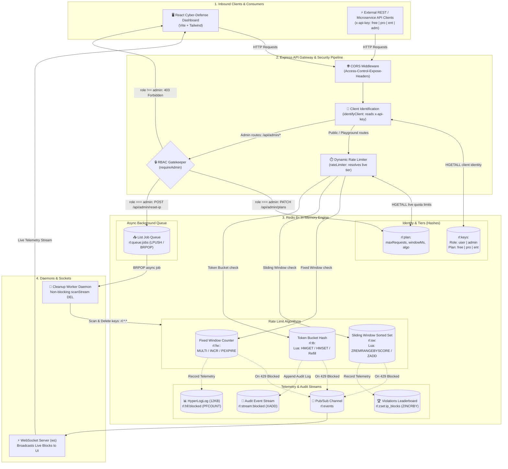
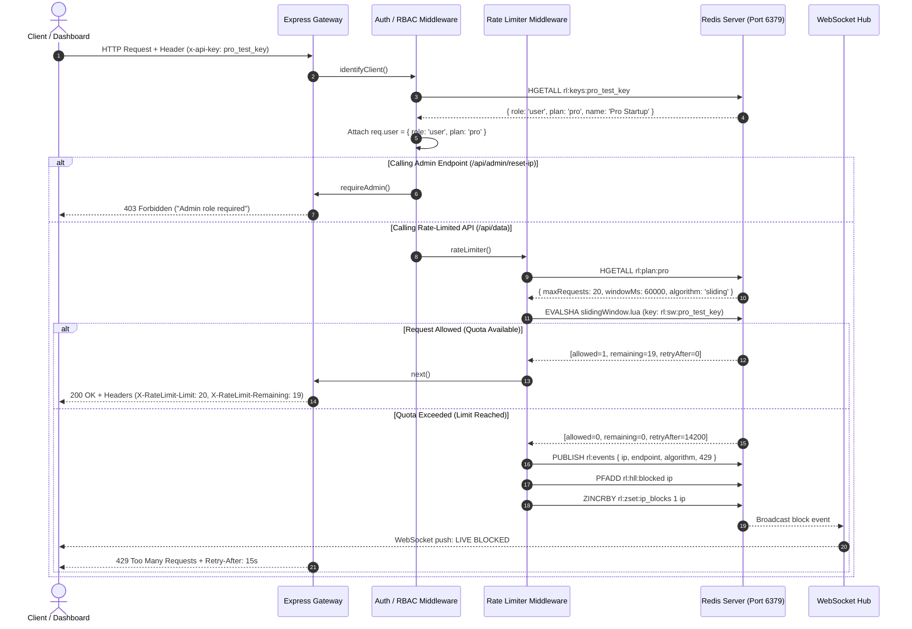

# 🛡️ Redis Shield — Distributed Rate Limiting & Defense Engine

A production-grade, distributed rate limiting and security telemetry engine built on **Redis 8+**, **Node.js/Express**, and **React (Vite)**.

Redis Shield demonstrates high-throughput distributed rate limiting using native Redis data structures, atomic Lua scripts, dynamic in-memory tier reconfiguration, role-based access control (RBAC), and real-time Pub/Sub audit feeds.

---

## 🏛️ System Architecture Diagram



---

## 🔁 Request Lifecycle Sequence Diagram



---

## 🗄️ Redis Data Structure Architecture Map

```
========================================================================================
                          REDIS SHIELD KEY SCHEMA MAP
========================================================================================

  1. CLIENT IDENTITIES & ROLES (Redis Hashes)
     Pattern : rl:keys:<api_key>
     Example : rl:keys:pro_test_key -> { role: "user", plan: "pro", name: "Pro Startup" }
     Purpose : Constant O(1) identity lookup on every incoming HTTP connection.

  2. DYNAMIC TIER CONFIGURATION (Redis Hashes)
     Pattern : rl:plan:<plan_name>
     Example : rl:plan:pro -> { maxRequests: 20, windowMs: 60000, algorithm: "sliding" }
     Purpose : Real-time quota storage updated via PATCH without application restarts.

  3. FIXED WINDOW COUNTERS (Redis Strings / Transactions)
     Pattern : rl:fw:<client_id>:<window_id>
     Example : rl:fw:free_test_key:29490123 -> "4" (TTL: 60s)
     Command : MULTI -> INCR -> PEXPIRE -> EXEC

  4. SLIDING WINDOW LOGS (Redis Sorted Sets)
     Pattern : rl:sw:<client_id>
     Members : Score = Timestamp (ms), Value = Timestamp-Nonce
     Command : Atomic Lua script executing ZREMRANGEBYSCORE + ZCARD + ZADD + PEXPIRE

  5. TOKEN BUCKET STATES (Redis Hashes)
     Pattern : rl:tb:<client_id>
     Fields  : tokens (float), lastRefill (timestamp ms)
     Command : Atomic Lua script calculating sub-second token replenishment

  6. CARDINALITY TELEMETRY (Redis HyperLogLog)
     Key     : rl:hll:blocked
     Purpose : Fixed 12KB RAM tracking of millions of unique attacker IPs via PFCOUNT.

  7. VIOLATION LEADERBOARD (Redis Sorted Sets)
     Key     : rl:zset:ip_blocks
     Purpose : Ranked real-time counter of worst offending IPs via ZINCRBY / ZREVRANGE.

  8. AUDIT LOG STREAM (Redis Streams)
     Key     : rl:stream:blocked
     Purpose : Capped append-only audit trail (XADD ... MAXLEN ~ 1000) for compliance.

  9. BACKGROUND TASK QUEUE (Redis Lists)
     Key     : rl:queue:jobs
     Pattern : Producer: LPUSH rl:queue:jobs {"type":"reset_ip","ip":"::1"}
               Consumer: BRPOP rl:queue:jobs 2 (Worker Daemon)
========================================================================================
```

---

## 👥 Built-In Personas & RBAC Matrix

All 4 default client personas are automatically seeded into Redis Hashes on server boot:

| Persona Name | API Key (`x-api-key`) | Role (`role`) | Plan (`plan`) | Engine Algorithm | Default Quota | Admin Mutation Access |
| :--- | :--- | :--- | :--- | :--- | :--- | :--- |
| **Free Developer** | `free_test_key` | `user` | `free` | Fixed Window Counter | 5 req / 30s | ⛔ **Rejected (`403 Forbidden`)** |
| **Pro Startup** | `pro_test_key` | `user` | `pro` | Sliding Window Sorted Set | 20 req / 30s | ⛔ **Rejected (`403 Forbidden`)** |
| **Enterprise VIP** | `ent_test_key` | `user` | `enterprise` | Token Bucket Hash | 100 req / min | ⛔ **Rejected (`403 Forbidden`)** |
| **DevOps Master Admin** | `adm_test_key` | `admin` | `enterprise` | Token Bucket Hash | 100 req / min | ✅ **Authorized (`200 OK`)** |
| **Anonymous IP** | *(None / IP)* | `user` | `free` | Fixed Window Counter | 5 req / 30s | ⛔ **Rejected (`403 Forbidden`)** |

> **Security Concept**: Quota capacity is completely decoupled from permissions. Even though **Enterprise VIP** clients have a massive 100 req/min quota, their role is `user`. Attempting to flush IP bans or patch tier rules returns `403 Forbidden`. Only the `admin` role (`DevOps Master Admin`) is permitted to execute administrative mutations.

---

## 🚀 Quick Start Guide

### 1. Prerequisites
- [Node.js](https://nodejs.org/) (v18.0.0 or higher)
- [Redis](https://redis.io/) (v7.0+ or Redis 8 Stack) running on port `6379`:
  ```bash
  # Quick Redis Docker launch
  docker run -d --name redis-shield -p 6379:6379 redis:latest
  ```

### 2. Installation
```bash
# Clone the repository
git clone https://github.com/<your-username>/redis-shield.git
cd redis-shield

# Install root & backend dependencies
npm install

# Install client dependencies
cd client
npm install
cd ..
```

### 3. Environment Setup
Create a `.env` file in the root directory (matching `.env.example`):
```env
REDIS_HOST=127.0.0.1
REDIS_PORT=6379
REDIS_PASSWORD=
PORT=3000
ADMIN_KEY=shield_admin_master_key
```

### 4. Running the Application

**Terminal 1 — Backend & Worker Daemon**:
```bash
node server/src/server.js
```
*(Spawns Express server on port 3000, connects Redis main & subscriber clients, seeds default plans & keys, and starts the background list worker).*

**Terminal 2 — Frontend Cyber-Defense Dashboard**:
```bash
cd client
npm run dev
```

Visit **`http://localhost:5173`** in your browser.

---

## 📡 API Reference

### 1. Client Testing Endpoints
- `GET /api/ping`: Healthcheck endpoint with rate limit bypass headers.
- `GET /api/keys`: Public metadata discovery returning seeded personas.
- `GET /api/data`: Fixed window counter test endpoint (requires `x-api-key`).
- `POST /api/submit`: Sliding window ZSET test endpoint (requires `x-api-key`).
- `GET /api/token`: Token bucket test endpoint (requires `x-api-key`).

### 2. Standard HTTP Response Headers
All protected endpoints return IETF-compliant diagnostic headers exposed via CORS:
- `X-Client-Role`: Current client authorization role (`user` or `admin`).
- `X-Client-Plan`: Current rate limit tier (`free`, `pro`, or `enterprise`).
- `X-Client-Key`: Identified client API key.
- `X-RateLimit-Limit`: Maximum requests permitted in the window.
- `X-RateLimit-Remaining`: Remaining request allowance in current window.
- `X-RateLimit-Latency-Ms`: Atomic Redis / Lua execution latency in milliseconds.
- `X-Redis-Algorithm`: Algorithm executed (`fixed_window_counter`, `sliding_window_zset`, `token_bucket_hash`).
- `Retry-After`: Seconds to wait before retrying (returned on `429 Too Many Requests`).

### 3. Protected Admin Endpoints (`role: "admin"` required)
- `GET /api/admin/analytics`: Real-time system stats (ops/s, memory, P99 latency, HLL unique IPs).
- `GET /api/admin/plans`: Current configurations of all tiers from Redis Hashes.
- `PATCH /api/admin/plans/:name`: Update tier limits in Redis Hashes without restarting the server.
- `POST /api/admin/reset-ip`: Enqueue non-blocking IP unblock job processed by worker daemon.
- `GET /api/admin/blocked`: Stream audit history from `rl:stream:blocked`.

---

## 💻 Cyber-Defense Dashboard Views

1. **Live Telemetry & Ribbon**: Real-time Redis ingestion rate (ops/s), RAM allocation, P99 Lua latency, and 24h unique blocked IPs via HyperLogLog.
2. **API Playground**: Interactive request testing with active Persona Switcher, 7x Burst Blaster, and real-time Response Header Inspector.
3. **Dynamic Tier Manager**: Visual editor for Free, Pro, and Enterprise tiers with live RBAC enforcement banner.
4. **Redis Stream Audit Inspection**: Searchable audit log table with filterable IP and route queries.
5. **Security Mitigation**: Emergency IP flush console pushing unblock jobs to Redis Lists for worker consumption.

---

## 📄 License
MIT License. Open-source for developers building resilient distributed systems.
